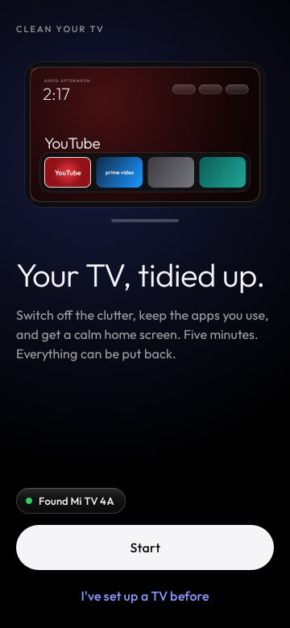
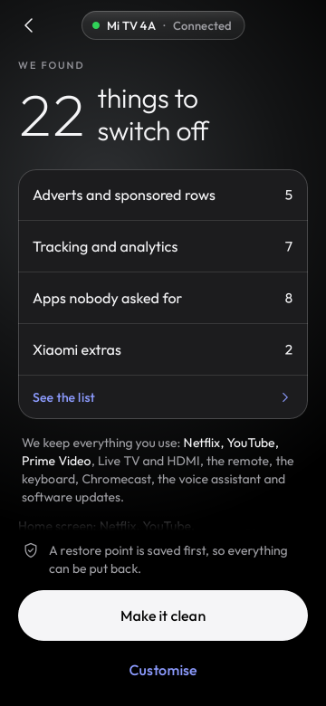
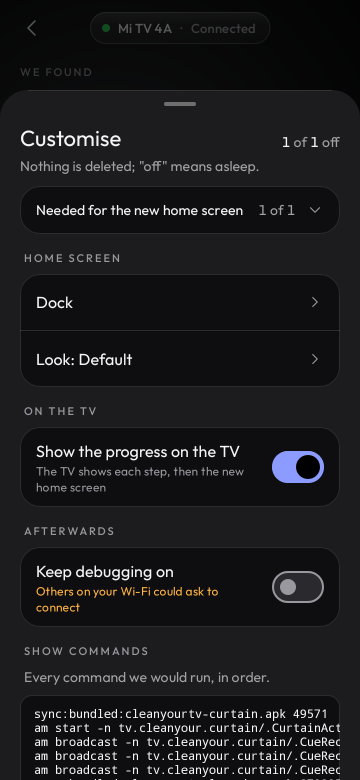
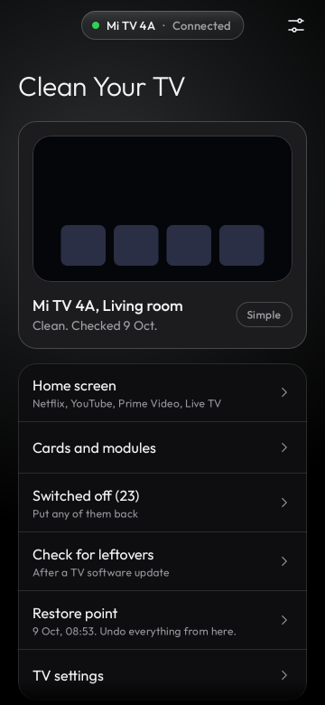
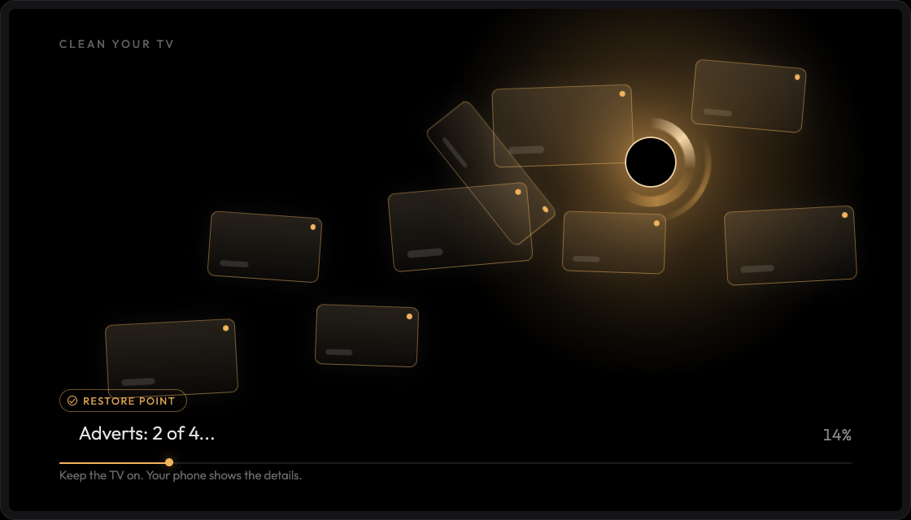
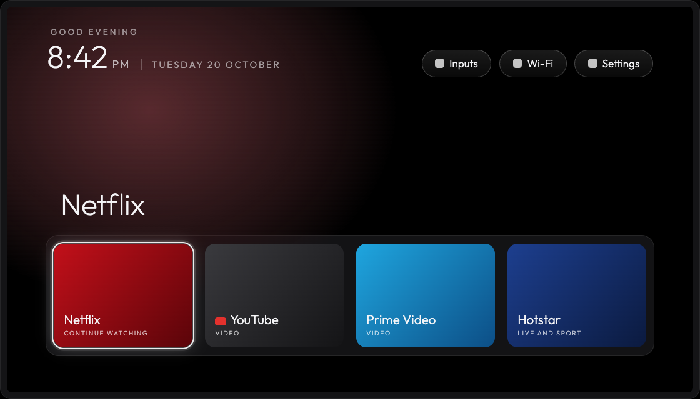

# Clean Your TV

A phone app that tidies up an Android TV over your Wi-Fi. It switches off the adverts, tracking
and preloaded apps nobody asked for, installs a calm home screen, shows its progress on the TV
while it works, and keeps a restore point so every change can be put back.

The home screen is [Clean Your TV](https://github.com/Gathin23/cleanyourtv), the open source
launcher by Gathin; this app is the friendly way to set it up without a computer.

<p>
  
  
  
  
</p>
<p>
  
  
</p>

The phone screens are the app's screenshot tests; the TV pictures are design frames of the
progress screen and the launcher.

## What it does

1. **Finds your TV** on the Wi-Fi and walks you through switching on network debugging with the
   remote (about a minute, the only fiddly part).
2. **Looks before it touches anything.** It reads what is installed and matches the TV against
   community tested profiles, then shows what it would switch off, grouped and counted, and what
   it keeps: your streaming apps, Live TV and HDMI, the remote, the keyboard, Chromecast, the voice
   assistant and software updates.
3. **Makes it clean** when you say so: a restore point is saved first, the clutter is switched off
   (disabled, never uninstalled), the Clean Your TV home screen is installed with a dock of the
   apps you use, and the TV shows a calm progress animation while the phone works.
4. **Stays useful afterwards:** put any app back, check for leftovers after a TV software update,
   change the dock or the look, or undo everything from the restore point.

## Install

Clean Your TV is distributed as a signed APK on
[GitHub Releases](https://github.com/udhaykumarbala/cleanyourtv-app/releases). You need:

- an Android phone with Android 9 or newer and a screen lock (the app asks for it once per
  session before its first change to the TV);
- an Android TV, Google TV or Fire TV on the same Wi-Fi.

Download `cleanyourtv-<version>.apk` from the latest release, open it on the phone and allow your
browser or file manager to install it.

### Check the download

Each release lists the APK's SHA-256 and the signing certificate. Every release is signed by the
same key, whose certificate SHA-256 is (also in [docs/release-signer.sha256](docs/release-signer.sha256)):

```
eaf7af3867bb29ff4bb038854842c93f42ffe4198a087e611cb18f925201cd65
```

On a computer with the Android build tools:

```bash
sha256sum cleanyourtv-0.1.0.apk      # compare with the release notes
apksigner verify --print-certs cleanyourtv-0.1.0.apk
# Signer #1 certificate SHA-256 digest: eaf7af3867bb29ff4bb038854842c93f42ffe4198a087e611cb18f925201cd65
```

Android itself refuses an update signed by any other key, so after the first install every update
is checked for you.

The build is reproducible. For every release tag CI builds the unsigned APK twice from the public
source and publishes it with its SHA-256, and `scripts/verify-release.sh` (or the release
workflow's verify job) checks that the published APK is exactly that build plus a signature.

## Supported TVs

- **131 TV profiles** from the community lists in the upstream launcher repository (v2.5.0): 46
  brands, among them TCL (24 models, Hitachi's TCL build included), Sony (17), Xiaomi (17),
  Hisense, Philips, Amazon Fire TV, Panasonic, XGIMI, BenQ, NVIDIA Shield, Skyworth, Haier, CHiQ,
  onn, Google, Vestel-made sets (JVC, Toshiba, Cecotec) and the Freebox Player, on Android TV,
  Google TV, Fire OS and TCL's China builds. Some sets get the clean-up only and keep their own
  home screen: Fire TV, TCL's China builds, Android 7, and TVs whose home screen the app cannot
  switch safely.
- **A brand fallback** for a model nobody has profiled yet: for Amazon, Hisense, Panasonic,
  Philips, Sony, TCL, XGIMI and Xiaomi the app switches off only what every profile of that brand
  agrees on, and says that it is being careful. More can be switched off by hand under Customise.
- Other Android TVs get the home screen, and the app suggests only what it is sure about, which
  may be nothing.

The TV needs network debugging (ADB on port 5555). On TVs that only offer Wireless debugging
with a pairing code, pair once from a computer; the app shows the three commands. Pairing from
the phone itself is planned.

Your TV is not listed? See [CONTRIBUTING.md](CONTRIBUTING.md#propose-a-tv-profile).

## How it stays safe

- **A plan first.** Nothing runs until you have seen the list of what will be switched off and
  tapped "Make it clean". Customise lets you change any of it.
- **Show commands.** Every command the app would send to the TV is listed, in order, before it
  runs.
- **Restore point.** Saved on the phone before the first change. "Undo everything" puts the TV
  back the way it was, and "Save a copy" exports a zip with plain restore scripts you can run from
  any computer with adb, without this app.
- **Nothing deleted.** Apps are disabled for the main user, not uninstalled, so each one can be
  put back. Pieces the TV needs (Google Play services, the Play Store, Wi-Fi, Bluetooth for the
  remote, the TV's inputs and settings, the debugging service itself and more) are on a protected
  list and never touched.
- **A watchdog on the TV.** Before the home screen changes, a short timer starts on the TV itself.
  If the phone does not confirm within 150 seconds that the new home screen works (Wi-Fi drops,
  the phone dies, the launcher does not start), the TV puts its own launcher back by itself.
- **Undo, one app or everything.** From Manage you can put back any switched off app or undo the
  whole setup.
- **Pinned software.** The launcher and the TV progress screen are bundled in the APK, built
  reproducibly from pinned sources and checked by size, SHA-256 and signer before they are
  installed. Optional add-on apps come from a signed list and are checked the same way.
- **Debugging off afterwards.** Unless you choose to keep it on, the app switches network
  debugging off again at the end, so nobody else on the Wi-Fi can connect to the TV.

## Privacy

- No accounts, no analytics, no advertising, no crash reporting service.
- On your home network the app talks only to the TV you pick (ADB on port 5555) and listens for
  TVs announcing themselves (mDNS).
- On the internet it talks only to GitHub (`github.com`, `api.github.com`,
  `objects.githubusercontent.com`, `release-assets.githubusercontent.com`), and only when you ask:
  "Check for updates" makes one request for the latest release, and installing an optional add-on
  downloads it from its GitHub release. The launcher and the TV progress screen are inside the
  APK, so a normal setup makes no internet request at all. GitHub sees your phone's address and a
  generic user agent.
- The key the TV trusts lives in the phone's Android Keystore and never leaves the phone.
  Restore points stay on the phone unless you save a copy yourself.
- "Share diagnostics" shows you a preview first and removes addresses, serial numbers, keys and
  codes; nothing is sent until you choose where to share it.
- Permissions: internet, network state, Wi-Fi multicast (to find the TV), a foreground service
  while it works on the TV, notifications, and the screen lock prompt (biometric or PIN). No location, storage, camera or contacts.

## Build from source

```bash
git clone --recurse-submodules https://github.com/udhaykumarbala/cleanyourtv-app.git
cd cleanyourtv-app
./gradlew check assembleDebug        # JDK 21 and the Android SDK
```

[CONTRIBUTING.md](CONTRIBUTING.md) has the details: tests, screenshot goldens, the module rules
and how releases are built and signed. How the app was designed and reviewed is kept in
[docs/history](docs/history/README.md).

## Credits

- [Clean Your TV](https://github.com/Gathin23/cleanyourtv), the TV launcher by
  [Gathin](https://github.com/Gathin23), which this app installs, and its community contributors,
  whose per TV clean-up lists and test reports are the profiles this app uses. Each profile names
  who tested it.
- The ADB protocol code started from [dadb](https://github.com/mobile-dev-inc/dadb) by mobile.dev
  (Apache 2.0, see [adb/wire/NOTICE](adb/wire/NOTICE)).
- The [Outfit](https://github.com/Outfitio/Outfit-Fonts) typeface (SIL Open Font License 1.1).

Full list: [THIRD-PARTY-NOTICES](THIRD-PARTY-NOTICES).

## Licence

[MIT](LICENSE), like the upstream launcher. Security issues: see [SECURITY.md](SECURITY.md).
