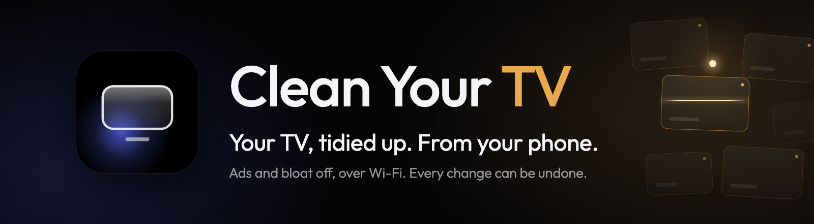
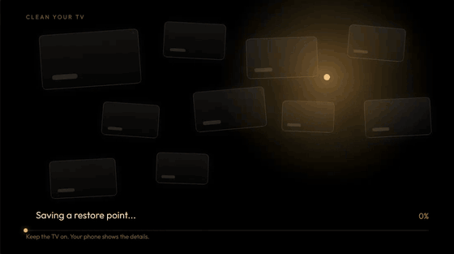

<p align="center">
  
</p>

<p align="center">
  <a href="https://github.com/udhaykumarbala/cleanyourtv-app/releases/latest"></a>
  
  
  <a href="LICENSE"></a>
</p>

**Clean Your TV** is a free, open source phone app that tidies up an Android TV, Google TV or Fire
TV over your Wi-Fi. It switches off the adverts, tracking and preloaded apps nobody asked for,
installs a calm home screen with the apps you use, and keeps a restore point so every change can
be put back. No computer, no cables, no root.

<p align="center">
  
  <br><sub>What your TV shows while the phone works.</sub>
</p>

The home screen is [Clean Your TV](https://github.com/Gathin23/cleanyourtv), the open source
launcher by Gathin, and the TV lists come from its community. This app is the friendly way to set
it up from a phone.

## Get started

1. **Download** `cleanyourtv-<version>.apk` from the
   [latest release](https://github.com/udhaykumarbala/cleanyourtv-app/releases/latest) on an Android
   phone (Android 9 or newer, with a screen lock), and open it to install.
2. **Open the app** on the same Wi-Fi as the TV. It finds the TV and walks you through switching
   on network debugging with the remote. That takes about a minute and is the only fiddly part.
3. **Check the plan and tap "Make it clean".** About five minutes later the TV has its new home
   screen.

<p align="center">
  
  
  
  
</p>

## What it does

- **Looks first.** Reads what is installed, matches the TV against community tested profiles, and
  shows what it would switch off and what it keeps, before anything happens.
- **Keeps what matters.** Your streaming apps, Live TV and HDMI, the remote, the keyboard,
  Chromecast, the voice assistant and software updates stay on.
- **Cleans gently.** Apps are switched off, never uninstalled, and a restore point is saved before
  the first change.
- **Gives you a new home screen.** The Clean Your TV launcher with a dock of your apps, in up to
  three rows you reorder by dragging.
- **Stays useful.** Put any app back, check for leftovers after a TV update, change the dock or the
  look, or undo everything.

<p align="center">
  
</p>

## Safe by design

- **You see every step.** Nothing runs until you have seen the plan. Customise shows every command
  the app would send, in order.
- **Nothing is deleted.** Apps are disabled for the main user, so each one can be put back. Wi-Fi,
  the Play Store, the remote, the TV's inputs and the pieces Android needs are protected and never
  touched; accessibility, casting, voice and updates go off only if you choose.
- **Undo anything.** Put back one app or everything from the restore point. "Save a copy" exports
  plain restore scripts that work from any computer with adb, without this app.
- **A watchdog on the TV.** If the phone does not confirm the new home screen within 150 seconds
  (the Wi-Fi drops, the phone dies), the TV puts its own home screen back by itself.
- **Careful where it counts.** On TVs where switching the home screen is known to cause trouble,
  the app does the clean-up only and says why.
- **Debugging off afterwards.** The app switches network debugging off at the end unless you keep it on.

<details>
<summary><b>Supported TVs</b></summary>

- **131 TV profiles from 46 brands**, from the community lists in the upstream launcher repository
  (v2.5.0): TCL (24 models), Sony (17), Xiaomi (17), Hisense, Philips, Amazon Fire TV, Panasonic,
  XGIMI, BenQ, NVIDIA Shield, Skyworth, Haier, CHiQ, onn, Google, Vestel-made sets (JVC, Toshiba,
  Cecotec), the Freebox Player and more, on Android TV, Google TV, Fire OS and TCL's China builds.
  Each profile names who tested it.
- **A brand fallback** for a model nobody has profiled yet: for Amazon, Hisense, Panasonic,
  Philips, Sony, TCL, XGIMI and Xiaomi the app switches off only what every profile of that brand
  agrees on, and says it is being careful. More can be switched off by hand under Customise.
- **Other Android TVs** get the home screen, and the app suggests only what it is sure about.
- **Clean-up only** (the TV keeps its own home screen, and the app says why): Fire TV, TCL's China
  builds, Android 7, vendor home screens the app does not know, Chromecast with Google TV and the
  Google TV Streamer (the switch would cost casting), the Kalley and PRISM+ sets whose setup wizard
  returns at every boot, and TVs whose setup wizard has to stay on.

The TV needs network debugging (ADB on port 5555). On TVs that only offer Wireless debugging with
a pairing code, pair once from a computer; the app shows the three commands.

Your TV is not listed? See [CONTRIBUTING.md](CONTRIBUTING.md#propose-a-tv-profile).
</details>

<details>
<summary><b>Privacy</b></summary>

- No accounts, no analytics, no advertising, no crash reporting service.
- On your home network the app talks only to the TV you pick (ADB on port 5555) and listens for
  TVs announcing themselves (mDNS).
- On the internet it talks only to GitHub, and only when you ask: "Check for updates" makes one
  request for the latest release, and an optional add-on downloads from its GitHub release. The
  launcher and the TV progress screen are inside the APK, so a normal setup makes no internet
  request at all.
- The key the TV trusts lives in the phone's Android Keystore and never leaves the phone. Restore
  points stay on the phone unless you save a copy yourself.
- "Share diagnostics" shows a preview first and removes addresses, serial numbers, keys and codes.
- Permissions: internet, network state, Wi-Fi multicast (to find the TV), a foreground service
  while it works on the TV, notifications and the screen lock prompt. No location, storage, camera
  or contacts.
</details>

<details>
<summary><b>Check the download</b></summary>

Every release is signed by the same key, whose certificate SHA-256 is (also in
[docs/release-signer.sha256](docs/release-signer.sha256)):

```
eaf7af3867bb29ff4bb038854842c93f42ffe4198a087e611cb18f925201cd65
```

```bash
sha256sum cleanyourtv-0.2.0.apk                 # compare with the release notes
apksigner verify --print-certs cleanyourtv-0.2.0.apk
```

Android refuses an update signed by any other key, so after the first install every update is
checked for you. The build is reproducible: for every release tag CI builds the unsigned APK from
the public source, and `scripts/verify-release.sh` checks that the published APK is exactly that
build plus a signature.
</details>

## Build from source

```bash
git clone --recurse-submodules https://github.com/udhaykumarbala/cleanyourtv-app.git
cd cleanyourtv-app
./gradlew check assembleDebug        # JDK 21 and the Android SDK
```

[CONTRIBUTING.md](CONTRIBUTING.md) covers tests, screenshot goldens, the module rules and how
releases are built and signed. How the app was designed and reviewed is in
[docs/history](docs/history/README.md). What changed in each version: [CHANGELOG.md](CHANGELOG.md).

## Credits

- [Clean Your TV](https://github.com/Gathin23/cleanyourtv), the TV launcher by
  [Gathin](https://github.com/Gathin23), and its community contributors, whose clean-up lists and
  test reports are the profiles this app uses.
- The ADB protocol code started from [dadb](https://github.com/mobile-dev-inc/dadb) by mobile.dev
  (Apache 2.0, see [adb/wire/NOTICE](adb/wire/NOTICE)).
- The [Outfit](https://github.com/Outfitio/Outfit-Fonts) typeface (SIL Open Font License 1.1).

Full list: [THIRD-PARTY-NOTICES](THIRD-PARTY-NOTICES).

## Licence

[MIT](LICENSE), like the upstream launcher. Security issues: see [SECURITY.md](SECURITY.md).
